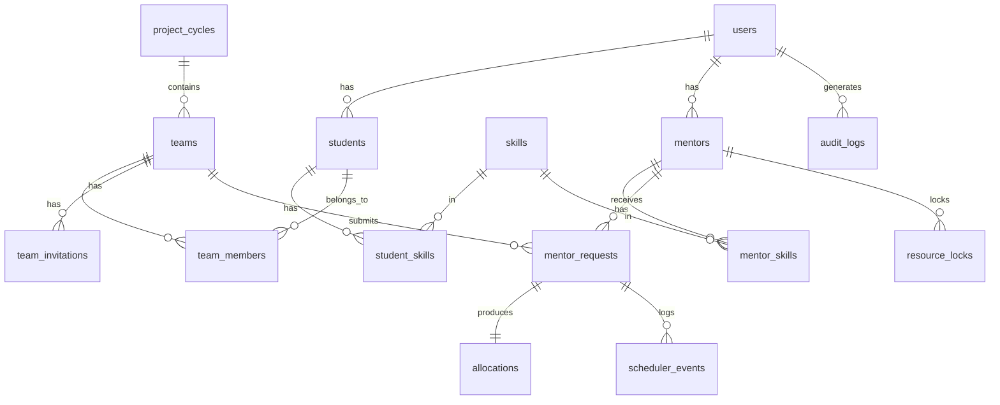

# SmartAlloc — Smart Project, Team & Mentor Allocation System

**BTECH CSE & ID | OSDBMS-V-2026-T084 | Team: The Incredibles**

---

## Prerequisites

| Tool | Version | How to get |
|------|---------|------------|
| Node.js | ≥ 20 LTS | https://nodejs.org/en/download — download Windows Installer |
| MySQL Server 8.0 | already installed | — |

> After installing Node.js, **close and reopen PowerShell** so `node` and `npm` are on PATH.

---

## First-time Setup

```powershell
# 1. Enter project folder
cd smartalloc

# 2. Install all dependencies
npm install
npm install --workspace=server
npm install --workspace=client

# 3. Set your MySQL password
#    Open server\.env and set DB_PASSWORD to your MySQL root password
notepad server\.env

# 4. Create database and all tables
npm run db:migrate

# 5. Load demo data
npm run db:seed
```

---

## Running the App

Open **two PowerShell windows**:

```powershell
# Window 1 — API server
npm run dev:server
```

```powershell
# Window 2 — React frontend
npm run dev:client
```

Open **http://localhost:5173** in your browser.

---

## Demo Credentials

| Role    | Name & Domain / Details               | Email                                 | Password     |
|---------|---------------------------------------|---------------------------------------|--------------|
| Admin   | System Admin                          | admin@smartalloc.edu                  | Admin@123    |
| Mentor  | Dr. Priya Sharma (OS/DBMS)            | priya.sharma@smartalloc.edu           | Mentor@123   |
| Mentor  | Prof. Rajesh Kumar (Machine Learning) | rajesh.kumar@smartalloc.edu           | Mentor@123   |
| Mentor  | Dr. Anita Singh (Web Development)     | anita.singh@smartalloc.edu            | Mentor@123   |
| Mentor  | Dr. Vikram Joshi (Cybersecurity)      | vikram.joshi@smartalloc.edu           | Mentor@123   |
| Mentor  | Prof. Sneha Patel (Cloud/DevOps)      | sneha.patel@smartalloc.edu            | Mentor@123   |
| Mentor  | Dr. Amit Verma (Artificial Intel)     | amit.verma@smartalloc.edu             | Mentor@123   |
| Mentor  | Prof. Neha Gupta (Mobile Computing)   | neha.gupta@smartalloc.edu             | Mentor@123   |
| Mentor  | Dr. Rohan Mehta (Data Engineering)    | rohan.mehta@smartalloc.edu            | Mentor@123   |
| Mentor  | Prof. Kavita Rao (Blockchain/Web3)    | kavita.rao@smartalloc.edu             | Mentor@123   |
| Student | Aditya Bisht (Team Leader)            | aditya.bisht@smartalloc.edu           | Student@123  |
| Student | Amritanshu Purohit                    | amritanshu.purohit@smartalloc.edu     | Student@123  |
| Student | Ananya Nautiyal                       | ananya.nautiyal@smartalloc.edu        | Student@123  |

---

## Running Tests

```powershell
npm run test:server
```

---

## Features Implemented

### Core Workflows
- Student/mentor/admin registration and JWT login
- Student profile with skills (used for matching)
- Team creation, membership, invitations
- Mentor directory with live capacity display
- Compatibility scoring (Jaccard skill overlap + domain match + capacity)
- Mentor request submission and queue
- FCFS and Priority scheduling with aging (anti-starvation)
- Allocation with mutex + SELECT FOR UPDATE (race-condition safe)
- Allocation cancellation

### OS Concepts
- In-process mutex (Map-based promise chain)
- Row-level locking via `SELECT ... FOR UPDATE` in transactions
- Counting semaphore (mentor `max_capacity`)
- ACID transactions with ROLLBACK
- Request states: pending → queued → processing → allocated/waiting/failed
- Resource-allocation graph (wait-for graph)
- Banker's Algorithm interactive simulator

### Admin Tools
- Scheduler control panel (run FCFS/Priority, view queue + event log)
- OS Monitor (resource states, process table, lock log, RAG)
- Banker's Algorithm simulator with editable matrices + step trace
- Analytics dashboard (charts, request stats, workload)
- Audit log with pagination

---

## Features NOT Yet Implemented

1. **Team invitation response UI** — backend done, no dedicated inbox page yet
2. **Mentor request reassignment** — route exists (`POST /allocations/:id/reassign`), logic not wired
3. **Admin cycle management** — no UI to create/close project cycles (manually set `is_active=1` in DB)
4. **Real-time updates** — no WebSocket; admin monitor requires manual refresh
5. **Email notifications** — no email sending on invite/allocation
6. **Admin: manage individual users** — list exists, but no edit/deactivate UI
7. **Round-Robin scheduling demo** — FCFS and Priority done, RR not implemented
8. **Password reset** — no forgot-password flow
9. **Mobile sidebar** — responsive layout done but sidebar toggle could be improved on small screens

---

## Troubleshooting

**"npm is not recognized"** — Install Node.js from https://nodejs.org then reopen PowerShell.

**MySQL connection refused:**
```powershell
# Run as Administrator
net start MySQL80
```

**Migration error on re-run** — Safe to ignore; all `CREATE TABLE` statements use `IF NOT EXISTS`.

**Port already in use** — Change `PORT` in `server/.env` and update the proxy in `client/vite.config.ts`.

---

## Architecture

```
React (Vite + Tailwind)  →  Express REST API  →  MySQL 8
                               │
                    ┌──────────┴──────────┐
              AllocationEngine        Scheduler
           (mutex + FOR UPDATE)   (FCFS / Priority)
                               │
                    BankersAlgorithm (simulator)
```

## ER Diagram (Mermaid)


